# 第 8 课详细讲义：无 NVLink 多卡通信破局（下）与终极闭环 —— TBO 双流计算通信重叠、跨 NUMA 双层规约与修改 vLLM/SGLang 实战指南

> **配套代码文件**：
> * CUDA 核心实现：[tbo_compute_comm_overlap.cu](./tbo_compute_comm_overlap.cu)
> * PyTorch JIT 评测脚本：[test_and_bench.py](./test_and_bench.py)
> * 对标 SGLang / vLLM 真实源码位置：
>   * SGLang: `python/sglang/srt/two_batch_overlap.py`、`sgl-kernel/`
>   * vLLM: `vllm/distributed/device_communicators/custom_all_reduce.py`、`csrc/`

---

## 一、核心概念 1：TBO（Two-Microbatch Overlap，双微批次计算通信重叠）

在无 NVLink 的 RTX 6000D 多卡机器上，即使我们在第 7 课把 PCIe 5.0 的 AllReduce / All-to-All 压缩到了极致，只要你的推理引擎是**串行执行**的：
$$\text{Total Latency} = T_{\text{Compute}} + T_{\text{PCIe Comm}}$$
那么在 PCIe 传数据的几十微秒里，RTX 6000D 上极其昂贵的第 5 代 Tensor Core 依然是 **100% 空闲等待** 的！

怎么让 $T_{\text{PCIe Comm}}$ 从总耗时公式里彻底消失？
答案就是 DeepSeek 和 SGLang / vLLM 极力推崇的 **TBO（双微批次重叠）** 或 **Shared-Routed Expert Overlap（共享专家与路由专家重叠）**：

```mermaid
gantt
    title 串行执行 vs TBO 双流重叠 (隐藏 PCIe 通信耗时)
    dateFormat X
    axisFormat %s

    section 传统串行 (单流)
    Microbatch 0 计算 (Compute) : 0, 40
    Microbatch 0 通信 (PCIe)    : 40, 75
    Microbatch 1 计算 (Compute) : 75, 115
    Microbatch 1 通信 (PCIe)    : 115, 150

    section TBO 重叠 (计算流)
    Microbatch 0 计算 (Compute) : 0, 40
    Microbatch 1 计算 (Compute) : 40, 80

    section TBO 重叠 (高优通信流)
    Microbatch 0 通信 (与 MB1 计算完全重叠)  : 40, 75
    Microbatch 1 通信 (PCIe)                 : 80, 115
```



### 实现 TBO 必须遵守的 3 条 CUDA 硬件铁律（见 [tbo_compute_comm_overlap.cu](./tbo_compute_comm_overlap.cu)）：
1. **通信 Kernel 严禁占满所有 SM（留出 SM 给计算流！）**：
   * 如果你的通信 Kernel 启动了 512 个 Block，把 RTX 6000D 的 ~180 个 SM 全部塞满，那么即使你在另一个 Stream 上发射了计算 Kernel，硬件也没有空闲 SM 去跑它，两个流依然会退化成串行！
   * **正确做法**：PCIe 5.0 的带宽只有 ~64 GB/s，根本不需要几百个 SM 就能跑满！只给通信 Kernel 分配 **`8 ~ 16` 个 Block**（使用 Grid-Stride Loop 循环处理数据），留出 **90% 以上的 SM** 给 `compute_stream` 跑 Tensor Core 矩阵乘！
2. **给通信流赋予最高硬件优先级 (`cudaStreamCreateWithPriority`)**：
   * 在 [test_and_bench.py](./test_and_bench.py) 的第 37-39 行，我们调用：
     ```cpp
     cudaDeviceGetStreamPriorityRange(&least_prio, &greatest_prio);
     cudaStreamCreateWithPriority(&comm_stream, cudaStreamNonBlocking, greatest_prio);
     ```
   * 这样一旦 `Microbatch 0` 的计算完成（触发 `evt_comp0_done`），硬件调度器会在下一个 Wave 立即抢占 16 个 SM 启动 PCIe 通信，而不会排在 `Microbatch 1` 的几百个计算 Block 后面苦等！
3. **全程使用 GPU 硬件事件 (`cudaEventRecord` + `cudaStreamWaitEvent`)，零 CPU 介入**：
   * 两个流之间的同步完全通过 GPU 硬件队列内部的 `cudaStreamWaitEvent` 完成，CPU 可以一口气把所有算子发射完，因此 **100% 兼容 vLLM / SGLang 的 CUDA Graph 整图捕获**！

---

## 二、核心概念 2：8 卡双路 CPU 服务器（Dual-Socket NUMA）的跨 Socket 通信优化

如果你使用的是 **8 张 RTX 6000D** 的服务器，先在终端运行：
```bash
nvidia-smi topo -m
```
你通常会看到：
* `GPU0 ~ GPU3` 挂在 **CPU Socket 0 (NUMA 0)** 的 PCIe Switch / Root Complex 下，彼此之间显示为 `PIX` 或 `PXB`（P2P 延迟极低，带宽跑满 50+ GB/s）；
* `GPU4 ~ GPU7` 挂在 **CPU Socket 1 (NUMA 1)** 下；
* 而 `GPU0` 到 `GPU4` 之间显示为 **`SYS`**（必须跨越两颗 CPU 之间的 UPI / Infinity Fabric 总线，延迟暴增 3~5 倍，且多卡同时跨 Socket P2P 极易引发总线拥塞甚至死锁！）。

### 怎么改 `custom_all_reduce.cu` 适配 8 卡双 Socket？—— 两阶段层次化规约（Two-Stage Hierarchical AllReduce）
不要让 8 张卡两两直接跨 `SYS` 互相读写！将 `custom_all_reduce.cu` 改为两步：
1. **阶段 1（Socket 内规约）**：
   * `GPU 0,1,2,3` 在 NUMA 0 内部通过高速 PCIe Switch 做一次 4 卡 P2P 规约，结果汇总在 `GPU 0`；
   * 同时 `GPU 4,5,6,7` 在 NUMA 1 内部做 4 卡 P2P 规约，结果汇总在 `GPU 4`。
2. **阶段 2（跨 Socket 单通道交换 + 广播）**：
   * **只让 `GPU 0` 和 `GPU 4` 这两张“组长卡”跨 CPU UPI 总线交换一次 FP8 压缩后的数据**（彻底消灭 8 卡争抢跨 Socket 总线的风暴！），算完总和后再在各自 Socket 内广播给组员卡。

---

## 三、终极实战手册：如何把这 8 门课的算子真正改到 vLLM / SGLang 里？

当你准备好在 RTX 6000D 上动手修改开源推理引擎时，按以下 4 步走，效率最高：

### 第 1 步：精准定位你要修改的源码文件
| 优化目标 | vLLM 源码路径 | SGLang (`sgl-kernel` / `flashinfer`) 路径 |
| :--- | :--- | :--- |
| **RMSNorm + FP8 动态量化融合** (第 1 课) | `csrc/layernorm_quant_kernels.cu` | `sgl-kernel/csrc/elementwise/` |
| **SwiGLU + 1x128 Group FP8 / UE8M0** (第 2 课) | `csrc/activation_kernels.cu` | `sgl-kernel/csrc/activation/` |
| **`sm_120` FP8 / NVFP4 CUTLASS GEMM** (第 3/4 课) | `csrc/quantization/cutlass_w8a8/` & `csrc/quantization/fp4/` | `flashinfer/include/flashinfer/gemm/` |
| **`sm_120` MoE Grouped GEMM** (第 5 课) | `csrc/moe/marlin_moe_wna16/` & `csrc/quantization/cutlass_w8a8/moe/` | `sgl-kernel/csrc/moe/` |
| **DeepSeek Paged MLA Decode** (第 6 课) | `csrc/attention/mla/` | `flashinfer/include/flashinfer/attention/mla.cuh` |
| **无 NVLink PCIe Custom AllReduce** (第 7/8 课) | `csrc/custom_all_reduce.cu` & `.cuh` | `sgl-kernel/csrc/allreduce/` |

### 第 2 步：配置针对 RTX 6000D (`sm_120`) 的增量编译环境
千万不要每次改一行 `.cu` 代码就跑 `pip install -e .` 全量重编所有架构（从 `sm_80` 编到 `sm_120` 要半小时）！
在编译 vLLM 或 `sgl-kernel` 时，在终端导出以下环境变量，**只编译 `12.0a` (`sm_120a`) 架构**，结合 `ccache` + `ninja`，改完一行 `.cu` 重新编译只需 **5~10 秒**：
```bash
export TORCH_CUDA_ARCH_LIST="12.0a"
export VLLM_FA_CMAKE_GPU_ARCHES="120a"
export MAX_JOBS=$(nproc)
export CMAKE_BUILD_PARALLEL_LEVEL=$(nproc)
# 使用 --no-build-isolation 进行本地增量编译
pip install -e . --no-build-isolation
```

### 第 3 步：独立 Benchmark 验证 $\rightarrow$ 端到端替换
1. 先用我们在每课里提供的 `test_and_bench.py`（基于 `torch.utils.cpp_extension.load_inline`）把你针对 `sm_120` 修改的 Kernel 调通，确保：
   * 与 PyTorch FP32 参考实现的精度误差达标；
   * 用 `ncu` 确认 Shared Memory 没有超过 **99KB**，且没有 Register Spilling（`local memory` 读写为 0）。
2. 将验证好的 Kernel 替换进 vLLM / SGLang 对应的 `.cu` 文件，跑 `vllm bench throughput` 或 `python -m sglang.bench_serving` 对比端到端 TTFT（首字延迟）与 TPOT（每 Token 生成延迟）！
